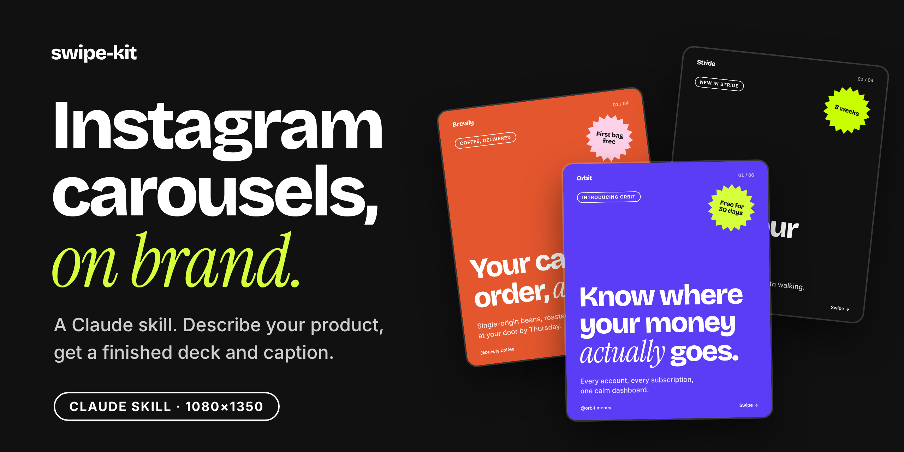
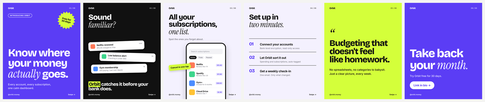
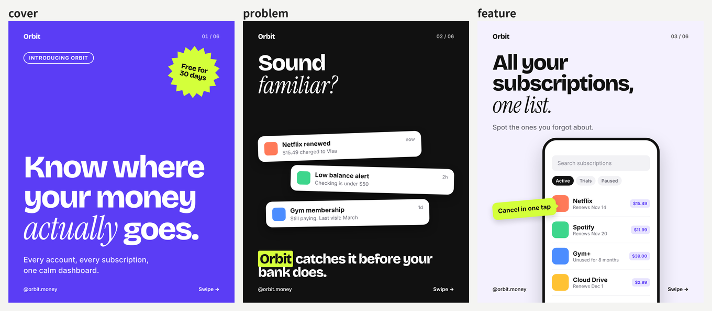
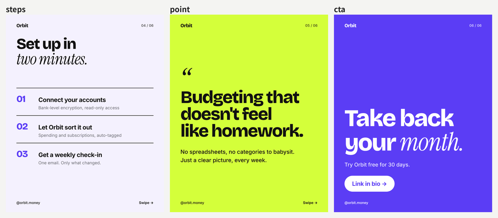
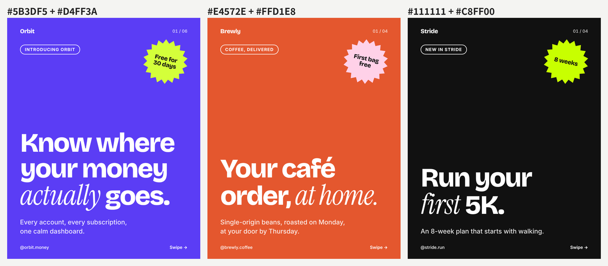
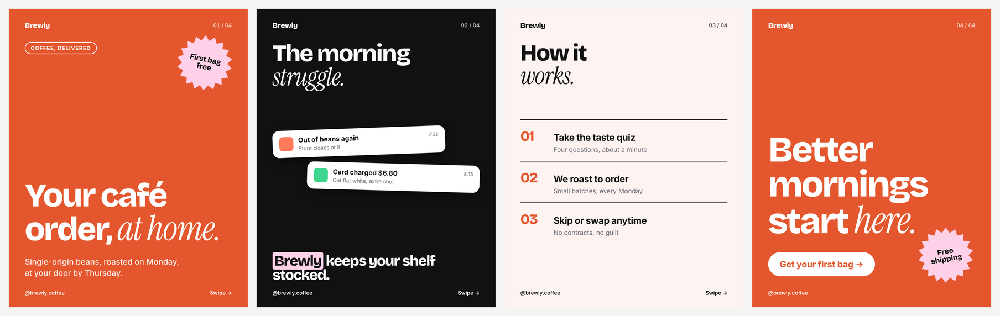
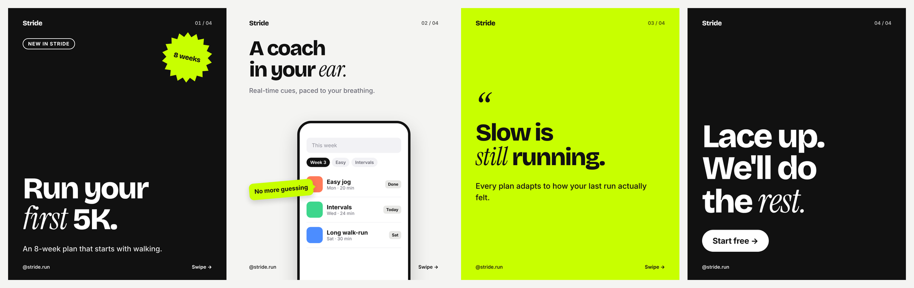

<p align="center"></p>

<p align="center"><b>A Claude skill that turns a product description into an on-brand Instagram carousel.</b></p>

<p align="center"><a href="README.md">한국어</a> · English</p>

Ask an AI for an Instagram carousel and you get a new design every time, gradients, emoji, and far too many words per slide.

This skill locks the design and only asks Claude for **planning and copy**. Big tight display type with one serif-italic word, color blocking, a scalloped sticker, notification cards, a phone mockup and proper carousel chrome, the visual language of modern product brands.

<p align="center"></p>

## Install

**Claude Code**

```bash
git clone https://github.com/seongwon030/swipe-kit
cp -r swipe-kit/skills/swipe-kit ~/.claude/skills/
```

**Claude app (claude.ai)**: download `swipe-kit.skill` from [Releases](../../releases) and upload it in Claude's skill settings. Code execution must be enabled.

Rendering needs Python 3, `playwright` (chromium) and `Pillow`. Fonts are bundled.

## Try it

> Make an Instagram carousel for Brewly, a coffee subscription that roasts to order and ships weekly. First bag is free. Brand color #E4572E, handle @brewly.coffee.

You get 1080×1350 PNGs, a contact-sheet preview and a caption with hashtags. Ask in Korean and the copy comes back in Korean.

## How it works

```
description ──▶ Claude plans slides & writes copy ──▶ spec.json ──▶ render.py ──▶ PNG + caption
```

Claude never writes HTML. It picks slide types, writes copy within per-field limits and fills a JSON spec. The renderer shrinks overflowing text and warns; Claude checks the preview and tightens the copy before handing it over.

<p align="center"></p>
<p align="center"></p>

Six types: `cover` (brand), `problem` (dark, notification cards), `feature` (light, phone + callout), `steps` (numbered editorial list), `point` (accent, pull-quote statement), `cta` (brand, button). Wrap a word in `*asterisks*` for the serif-italic accent.

## Two colors are enough

Pick a brand color and an accent. Text color flips between white and near-black for contrast, and the light background and badge tint are derived from the brand color.

<p align="center"></p>

<details>
<summary><b>Brewly</b> — coffee subscription</summary>

</details>

<details>
<summary><b>Stride</b> — running app</summary>

</details>

## License

Code: [MIT](LICENSE). Bundled fonts (Bricolage Grotesque, Instrument Serif, Inter, Pretendard) are under the SIL Open Font License 1.1; see `skills/swipe-kit/assets/fonts/`. All brands in the examples are fictional.
