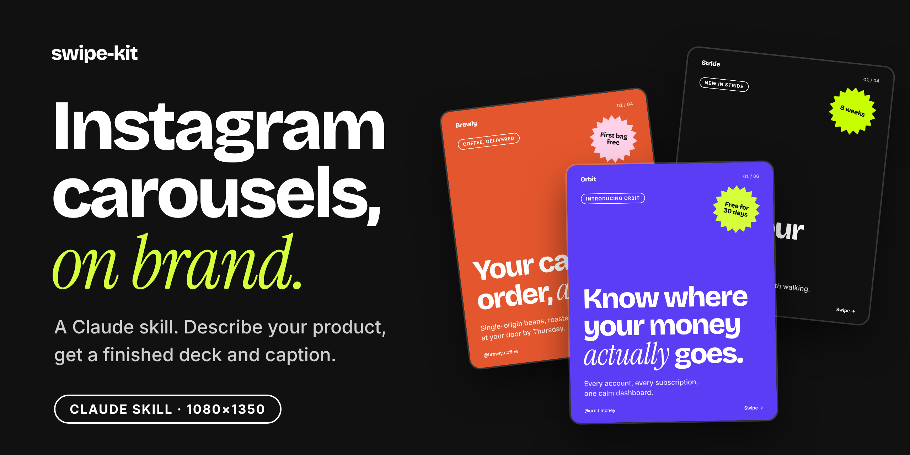
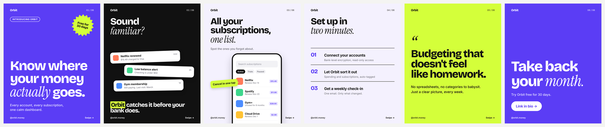
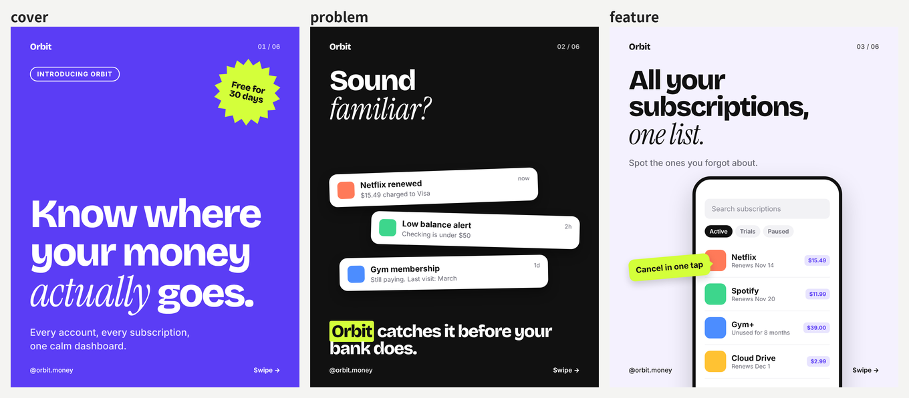
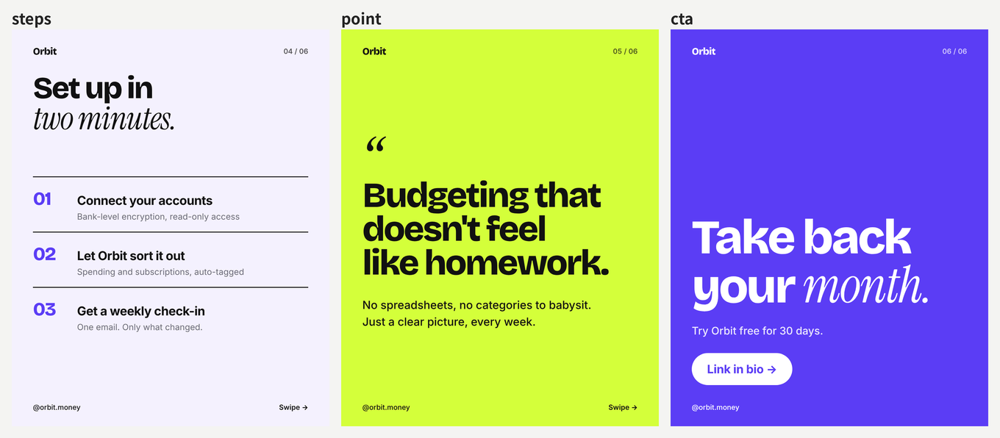
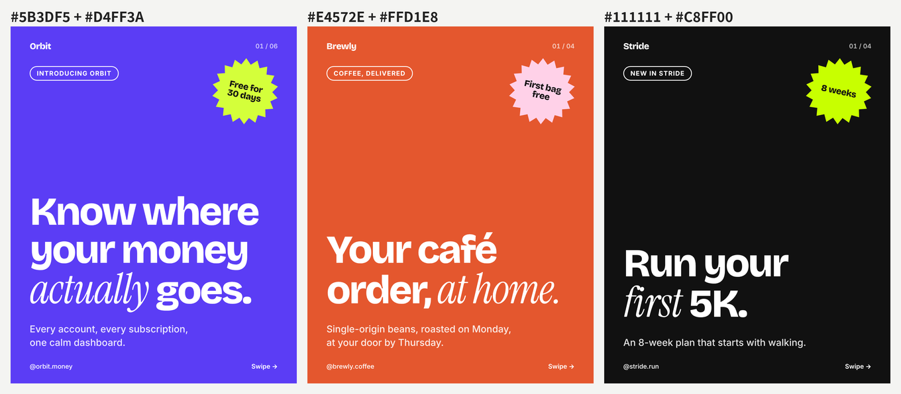
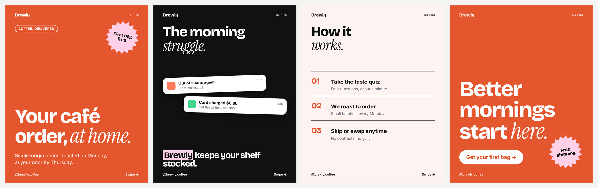
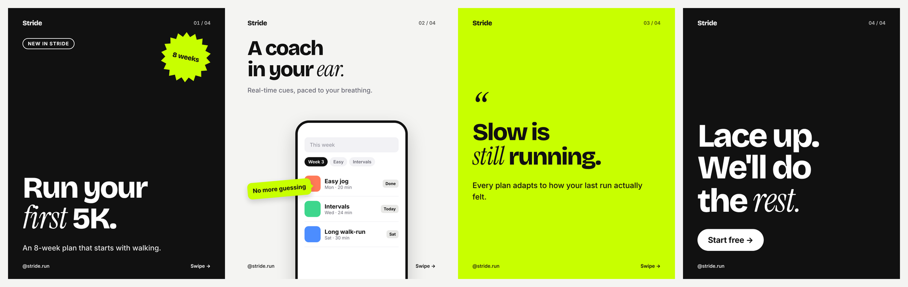
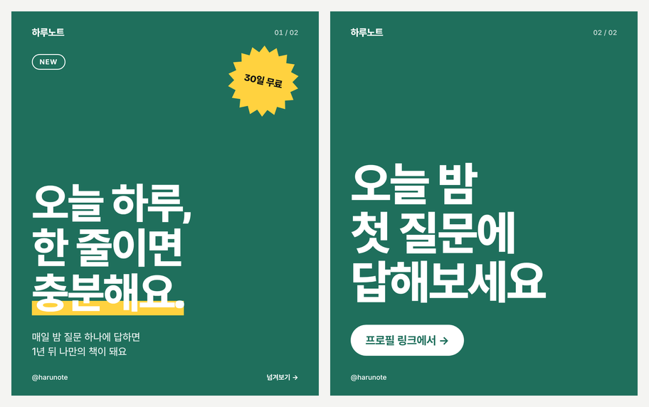

<p align="center"></p>

<p align="center"><b>제품 설명만 주면, Claude가 해외 브랜드 감성의 인스타 캐러셀을 기획하고 PNG로 뽑아주는 스킬</b></p>

<p align="center">한국어 · <a href="README.en.md">English</a></p>

AI한테 카드뉴스를 맡기면 매번 디자인이 달라지고, 그라데이션과 이모지가 들어가고, 한 장에 글이 너무 많아요.

이 스킬은 디자인을 고정해두고 Claude에게는 **기획과 문구**만 맡겨요. 큰 디스플레이 타입에 세리프 이탤릭 한 단어, 컬러 블로킹, 스티커 배지, 알림 카드, 폰 목업까지, 요즘 해외 프로덕트 브랜드 인스타에서 보는 문법을 그대로 담았어요.

<p align="center"></p>

## 설치

**Claude Code**

```bash
git clone https://github.com/seongwon030/swipe-kit
cp -r swipe-kit/skills/swipe-kit ~/.claude/skills/
```

**Claude 앱 (claude.ai)**

[Releases](../../releases)에서 `swipe-kit.skill`을 내려받아 Claude의 스킬 설정에서 업로드하세요. 코드 실행 기능이 켜져 있어야 해요.

렌더링에는 Python 3, `playwright`(chromium), `Pillow`가 필요해요. 폰트는 스킬 안에 들어 있어요.

```bash
pip install playwright pillow && playwright install chromium
```

## 처음 써보기

> Make an Instagram carousel for Brewly, a coffee subscription that roasts to order and ships weekly. First bag is free. Brand color #E4572E, handle @brewly.coffee.

한국어로 요청하면 문구도 한국어로 써요.

> 동네 빵집 예약 앱 '빵시계' 홍보 캐러셀 만들어줘. 갓 나온 빵 시간을 알려주고 미리 예약할 수 있어. 브랜드 컬러는 #7A3E1D.

결과로 장별 PNG(1080×1350), 전체 미리보기, 캡션과 해시태그가 나와요.

## 어떻게 동작하나요

```
제품 설명 ──▶ Claude가 장 구성 · 문구 작성 ──▶ spec.json ──▶ render.py ──▶ PNG + 캡션
                 (SKILL.md 규칙)                            (고정 템플릿)
```

Claude는 HTML이나 CSS를 쓰지 않아요. 어떤 장을 몇 장 쓸지 정하고, 글자 수 가이드에 맞춰 문구를 쓰고, JSON을 채우는 데까지만 해요. 렌더러는 문구가 넘치면 글자를 줄이고 경고를 띄우고, Claude는 미리보기를 직접 확인하고 문구를 다듬은 뒤에 넘겨요.

## 슬라이드 유형

유형마다 배경이 정해져 있어서, 순서대로 넘기면 브랜드 컬러 → 다크 → 라이트 → 액센트로 리듬이 생겨요. 모든 장에 워드마크, `01 / 06` 카운터, 핸들, `Swipe →`가 자동으로 붙어요.

<p align="center"></p>
<p align="center"></p>

| 유형 | 배경 | 쓰임 |
|---|---|---|
| `cover` | 브랜드 | 훅. 킥커 필, 스티커 배지, 하단 정렬 대형 제목 |
| `problem` | 다크 | 지금의 불편을 폰 알림 카드로 보여주고 제품이 답 |
| `feature` | 라이트 | 기능 + 폰 화면 + 화살표 콜아웃. 실제 스크린샷도 가능 |
| `steps` | 라이트 | 01 · 02 · 03 에디토리얼 리스트 |
| `point` | 액센트 | 풀쿼트처럼 크게 박는 한 문장 |
| `cta` | 브랜드 | 버튼 하나로 마무리 |

제목에서 `*단어*`로 감싼 부분은 영어에선 세리프 이탤릭, 한국어에선 형광펜 밑줄이 돼요.

## 색 두 개면 돼요

브랜드 컬러와 액센트만 정하면 글자색(흰색/검정)은 대비에 맞춰 자동으로 고르고, 라이트 배경과 배지 색은 브랜드 컬러에서 계산해요.

<p align="center"></p>

## 예시

모두 가상의 브랜드이고, `examples/`의 스펙을 그대로 렌더링한 결과예요.

<details open>
<summary><b>Brewly</b> — coffee subscription</summary>

</details>

<details>
<summary><b>Stride</b> — running app</summary>

</details>

<details>
<summary><b>하루노트</b> — 한국어 문구</summary>

</details>

```bash
python3 skills/swipe-kit/scripts/render.py examples/brewly.json out
```

## 문구 규칙

캐러셀은 디자인보다 글자 수에서 더 많이 무너져요. 스킬에 들어 있는 규칙이에요.

- 한 장에 아이디어 하나. 두 개면 장을 나눠요.
- 첫 초안에서 30% 덜어내기.
- 기능이 아니라 얻는 것. "Subscription tracking" 대신 "See every renewal before it hits your card".
- 강조는 제목당 한 곳만.
- 이모지, 느낌표 연타, "revolutionary · seamless · unlock" 같은 빈말, 사용자가 주지 않은 수치는 쓰지 않아요.

## 구조

```
skills/swipe-kit/
├── SKILL.md              작업 흐름, 문구 규칙, 디자인 규칙
├── references/
│   └── slide-types.md    유형별 필드와 글자 수 가이드
├── scripts/render.py     spec.json → PNG + 미리보기 + 캡션
└── assets/
    ├── template.css      디자인 토큰 + 슬라이드 스타일
    ├── example.json      예시 스펙 (Orbit)
    └── fonts/            Bricolage Grotesque, Instrument Serif, Inter, Pretendard
```

디자인을 바꾸려면 `assets/template.css`를, 새 슬라이드 유형은 `render.py`에 빌더 함수 하나와 CSS 블록 하나를 추가하면 돼요.

## 라이선스

코드는 [MIT](LICENSE). 번들 폰트 [Bricolage Grotesque](https://github.com/ateliertriay/bricolage), [Instrument Serif](https://github.com/Instrument/instrument-serif), [Inter](https://github.com/rsms/inter), [Pretendard](https://github.com/orioncactus/pretendard)는 SIL Open Font License 1.1을 따르며 전문은 `skills/swipe-kit/assets/fonts/`에 있어요. 예시의 브랜드는 모두 가상이에요.
